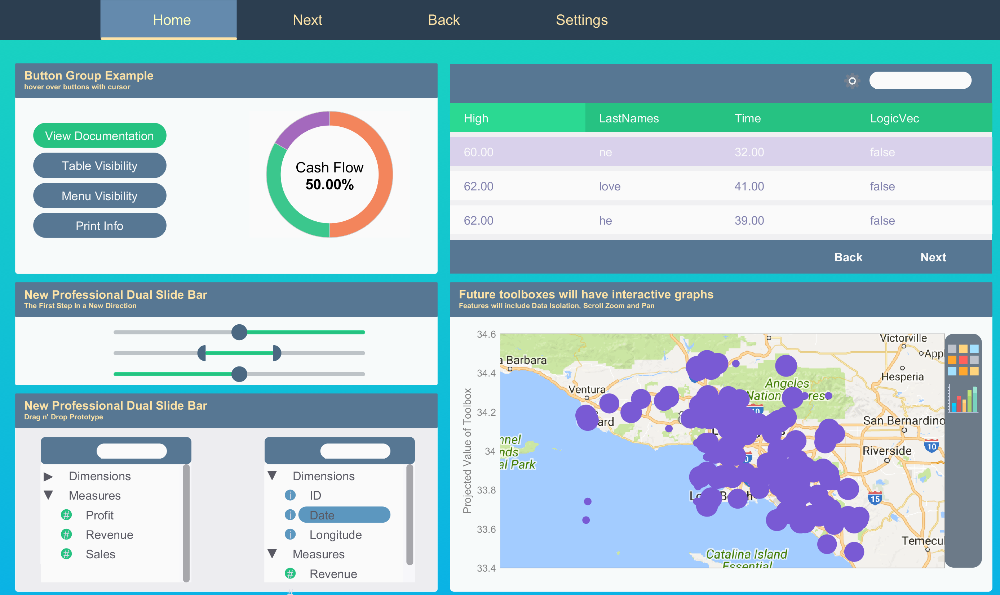

# MATLAB Data Analysis Toolkit

MATLAB toolkit I wrote in 2018 as an undergrad at RIT. It started as a GUI toolbox and grew into a set of functions for working with data: trimming and cleaning, categorizing, factor analysis, peak finding, joining tables, and plotting, including map plots. It also has custom UI objects you can drop into a figure, like menus, tables, panels, sliders, a wheel selector, and drag-and-drop trees, so you can build a small analysis app around the data.

I originally released it as the Modern GUI Toolbox, which is why that name still shows up in the toolbox file.

The installable file is `release/Modern GUI Toolbox II.mltbx`. The title packed inside that file is Modern GUI Toolbox III, version 11.1.



## Requirements

I packaged this with MATLAB R2017a (9.2). The toolbox metadata does not list any other system requirements. The example uses `imresize`, which comes with the Image Processing Toolbox.

## Install

The simple way is to double-click `release/Modern GUI Toolbox II.mltbx` in MATLAB. MATLAB will add the toolbox folders to your path.

To use the source instead, add the folders in this repo to your path:

```matlab
addpath(genpath('src'))
addpath('assets')
addpath(genpath('examples'))
```

Change the paths if this repo is not your current folder.

## Example

```matlab
run_Modern_Example
```

That opens `DemoFigure`, a GUIDE figure whose opening function runs `Example_Program.m`. The script builds the window in the screenshot above: a top menu, tables, buttons, sliders, a wheel control, two trees you can drag fields between, and an axes object. All positions are normalized.

`assets/` needs to be on the path, because the example loads `demo_variables.mat` and `backroundPic.jpg`.

`factorDemo.m` is a smaller script. It uses `factorMethods` to run a factor analysis and plot the result.

Most objects are created the same way. `funBuildo` makes a settings struct (type, tag, position, and any extra properties). `funControl` then builds the object and stores it on `handles`. The types used in the example are `menu`, `table`, `button`, `wheel`, `tree`, `slider`, `panel`, and `axeso`.

## Folders

```
src/data-methods/     DataTrimming, catMethods, dataMethods,
                      factorMethods, numMethods, peakMethods
src/ui/               funBuildo, funControl, and node helpers
src/ui-objects/       UI classes, grouped by kind
                      (axes, controls, menu, panel, pie,
                      table, tree-menu, universal)
src/core/             plotting, math, joins, binary helpers,
                      and a few interface utilities
src/general/          figure helpers, including findjobj
examples/             demo scripts and the GUIDE figure
examples/function-and-gui/
assets/               images and .mat files used by the example
release/              the original .mltbx file
docs/                 screenshot from the toolbox package
```

## Other code in the toolbox

`src/general/findjobj.m` is Yair Altman's function. I used it to make a search bar with rounded edges. `plot_google_map` by Zohar Bar-Yehuda and `parfor_progress` by Jeremy Scheff are in `src/core/interface/`. When I packaged the toolbox I noted that I never really used those last two.

## License

There are two license files, and they are different.

`LICENSE` is Mozilla Public License 2.0. That file was added when I first created the repo.

`license.txt` is a BSD-style license, Copyright 2018, AJ Geiger. The same BSD text is stored inside the `.mltbx` file. I left both here.

`findjobj.m` keeps Yair Altman's terms. The other bundled utilities belong to their authors.
